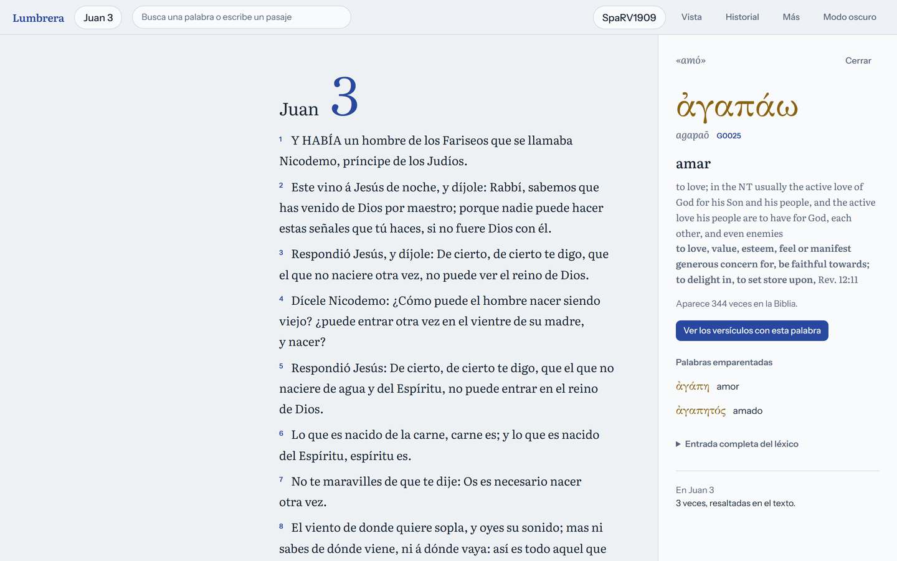
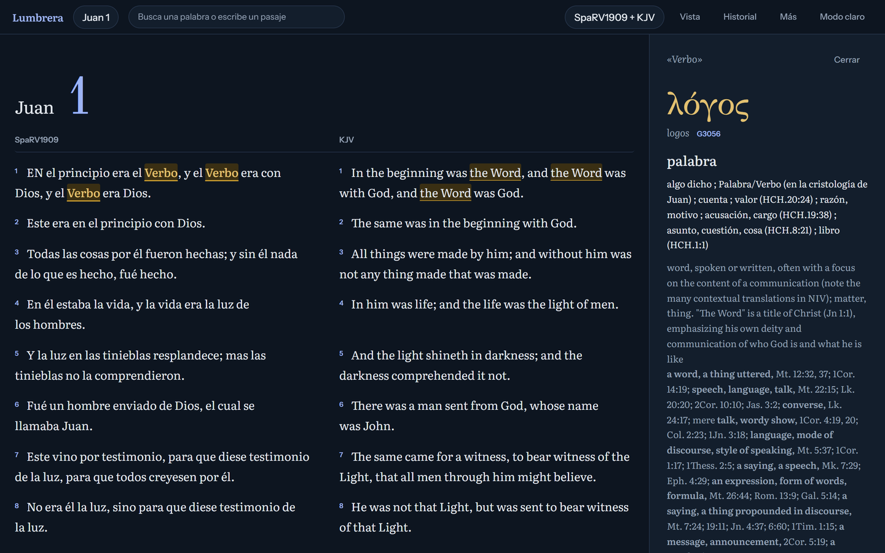
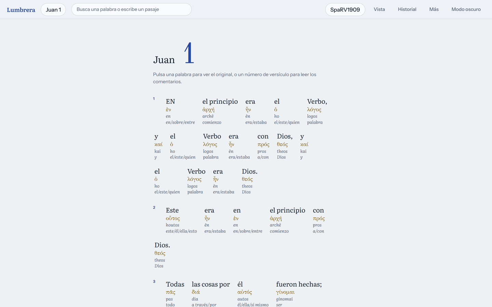
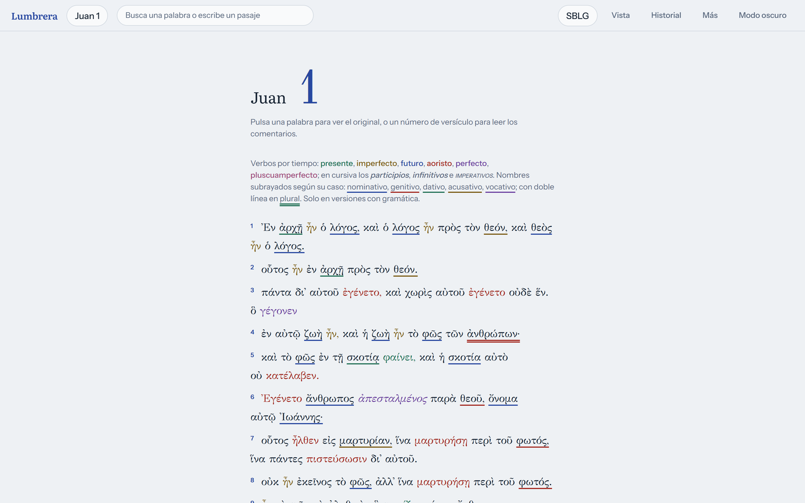
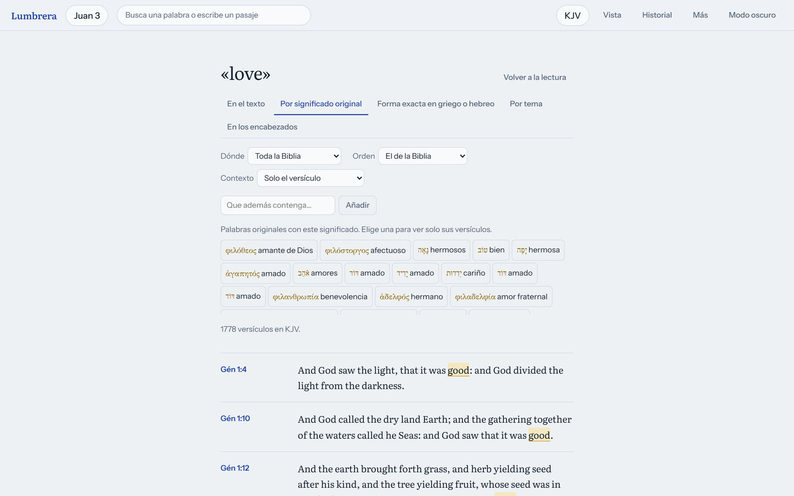
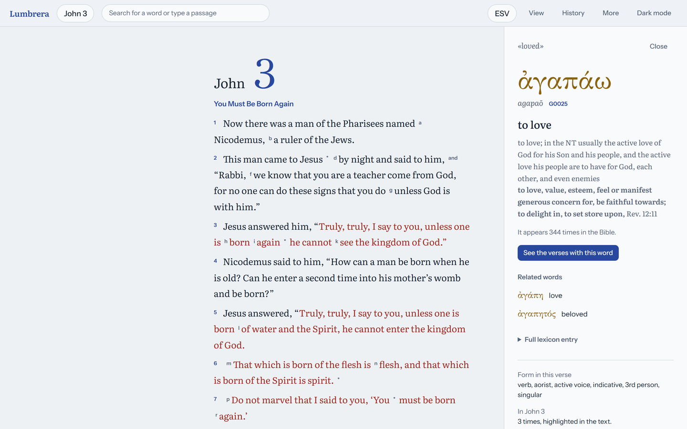
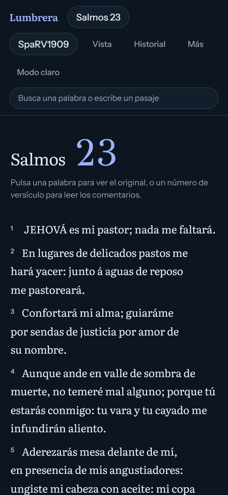

# Lumbrera

**Lumbrera** is a new, modern interface for [STEPBible](https://www.stepbible.org), the free Bible
study software from Tyndale House, Cambridge. It runs in the browser on top of the STEPBible
engine installed on your computer, and aims to offer everything the original interface does: read
and compare versions, study every word in the original Greek and Hebrew, and search the text in
depth, with a calmer, more readable design.

> Personal project. Lumbrera is an independent interface and is **not affiliated with or endorsed
> by STEPBible or Tyndale House**. It contains no Bible texts, lexicons or STEPBible code: it
> shows what your local STEPBible installation serves.



## What it does

**Read**
- Any book and chapter, passages typed by hand (`john 3:16`, `ps 23`) and multi-range passages.
- Section headings, footnotes, cross references and the words of Jesus in red.
- Several independent reading panels, text size, a dyslexia-friendly font, dark mode and a mobile
  layout.

**Compare versions**
- Three or more versions side by side, interleaved, word by word, or showing only the
  differences.
- A version picker by language, and installation or removal of STEPBible modules with progress.

**Study the original languages**
- Tap any word to see the Greek or Hebrew term, transliteration, gloss, definition, frequency and
  grammar, the full lexicon entry and related words.
- Highlight the same original word across the chapter, also between versions.
- Interlinear with original, transliteration, glosses and grammar.
- Colours by grammar (verb tense and mood; noun gender, number or case), each colour editable.
- The vocabulary of a verse and the most repeated words and topics of a passage.

**Search**
- Suggestions as you type: passages, words, topics, meanings and original words.
- By text (all words, any word or exact phrase), by original word or meaning, by exact Greek or
  Hebrew form, by topic (Nave's index) and in headings.
- Limited to a testament or to chosen books, combining conditions, with context around each hit.

**And also**: commentaries per verse, copy a verse with its reference, reading and search
history, bookmarks, a shareable address for every passage and search, and an interface in
English, Spanish, Portuguese and French.

[`PARIDAD.md`](PARIDAD.md) (in Spanish) tracks this feature by feature against STEPBible 26.1.2.

## Screenshots

| Compare versions and highlight a word (dark mode) | Interlinear |
| --- | --- |
|  |  |
| **Colours by grammar** | **Search by original meaning** |
|  |  |
| **English interface** | **Mobile** |
|  |  |

## How it works

```
Browser ── Lumbrera (React) ── /rest/... ──▶ STEPBible engine on your computer (http://localhost:8989)
                                               └─ Bible versions, lexicons and indexes you have installed
```

STEPBible's desktop app runs a small local server, the same one its own interface talks to.
Lumbrera is a single-page React app that calls that server's REST API (`/rest/...`) for passages,
word studies, searches and module management, and renders the results with its own design.

During development, Vite proxies `/rest` to the STEPBible engine, so there are no cross-origin
issues. The engine's address can be changed with the `STEP_URL` environment variable.

### Requirements

- **[STEPBible](https://www.stepbible.org/downloads.jsp) desktop, installed and running.**
  Lumbrera depends on it completely: without the engine there is nothing to show. It was built and
  tested against version 26.1.2.
- Node.js 20 or later.

### Running it

```bash
npm install
npm run dev        # http://localhost:5180, with STEPBible running on port 8989
```

To use a STEPBible engine elsewhere:

```bash
STEP_URL=http://192.168.1.10:8989 npm run dev
```

`npm run build` produces a static site in `dist/`. To serve it, put it behind a web server that
also forwards `/rest/` to the STEPBible engine.

## Built with

React 18, TypeScript and Vite, with no UI framework. Typefaces: Literata for reading, Instrument
Sans for the interface, GFS Didot for Greek, Frank Ruhl Libre for Hebrew, and Lexend for the
dyslexia-friendly mode.

## Licence

Lumbrera is licensed under the **[PolyForm Noncommercial License 1.0.0](LICENSE)**. You may use,
study and modify it for **non-commercial purposes only**: personal study, teaching, churches,
charities and other non-profit uses. Any commercial use requires written permission from the
author.

This licence covers Lumbrera's own code only. STEPBible, the Bible versions, lexicons and other
material it serves are separate works with their own licences and copyright holders.

Permission requests: felipecontactolp@gmail.com
